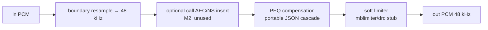
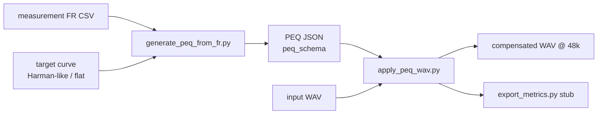

# filter-listen 架构：AI 滤波 / 试听补偿（48 kHz / 10 ms）

SPDX-License-Identifier: Apache-2.0

> 参考灵感（**仅文档级**）：openMHA 的图处理思路。本仓库为 **Apache-2.0 独立重写**，**不** vendor 任何 AGPL 代码。

## 实时图（播放 / 媒体下行）

| 参数 | 值 |
|------|-----|
| `sample_rate` | 48000 |
| `frame_samples` | 480 |
| `frame_ms` | 10 |
| `latency_budget_ms` | ≤ 10（本图目标） |
| 通道 | 默认 mono；立体声可双实例或后续扩展 |

配置入口：`configs/graph_48k_10ms.yaml`。

> **limiter / DRC**：本图 soft limiter 仅为防削波占位，**非听感定稿**；量产曲线与多带 DRC 另开听感+评测闭环。

## 离线补偿路径

1. 夹具 / 合成频响 CSV → 目标曲线。
2. `scripts/generate_peq_from_fr.py`：若已安装 **AutoEq（MIT，可选 pip）** 则尝试 AutoEq，解析不稳定时回退；默认与 `--no-autoeq` 走 **stdlib 峰值 EQ 拟合 stub**（P0 不依赖 NumPy/SciPy）。
3. 输出符合 `configs/peq_schema.json` 的 JSON（`sample_rate`、`bands[]` 的 `fc` / `Q` / `gain` / `type` 保持稳定，字段名与必填项不改）。`type` 为 `lowpass` 或 `highpass` 时实现忽略 `gain`：RBJ 低通 / 高通通带增益为 0 dB。
4. `scripts/apply_peq_wav.py` 按帧（480）级联 biquad。
5. `scripts/export_metrics.py` 写出客观指标 JSON。未提供频响时 `fr_rmse_db` 为 null；demo 合成夹具会写入算出来的 dB RMSE，并在 notes 中标明该数不宣称准入、非听感定稿。

## 模块边界

| 节点 | 实现 | 说明 |
|------|------|------|
| boundary resample | `graph.py` hook + 线性插值 stub | 量产替换为高质量 SRC |
| call insert | stub，默认关闭 | 通话 AEC/NS 旁路点；本骨架不启用 |
| PEQ | `peq.py` | 对应 music_eq / post_eq 的可移植 schema。`lowpass` / `highpass` 忽略仍必填的 schema `gain`（RBJ 通带 0 dB） |
| soft limiter | `graph.py` | 对应 mblimiter / drc 的**工程占位 stub**；**非听感定稿**，不得当作品控曲线 |

## 合规

- 本树 **禁止** 引入杰理 `.a` / `.bin` / `.fw` / 密钥 / SDK 源。
- openMHA：**参考重写**，不拷贝 AGPL 源。
- AutoEq：可选依赖，不 vendor 整仓。

相关：`docs/jieli_capability_map.md`。
